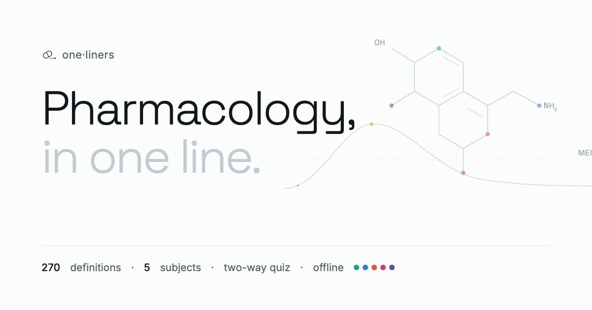
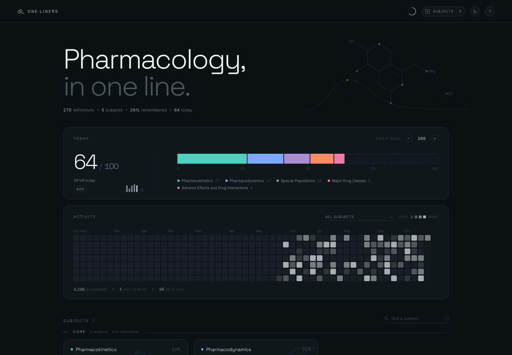
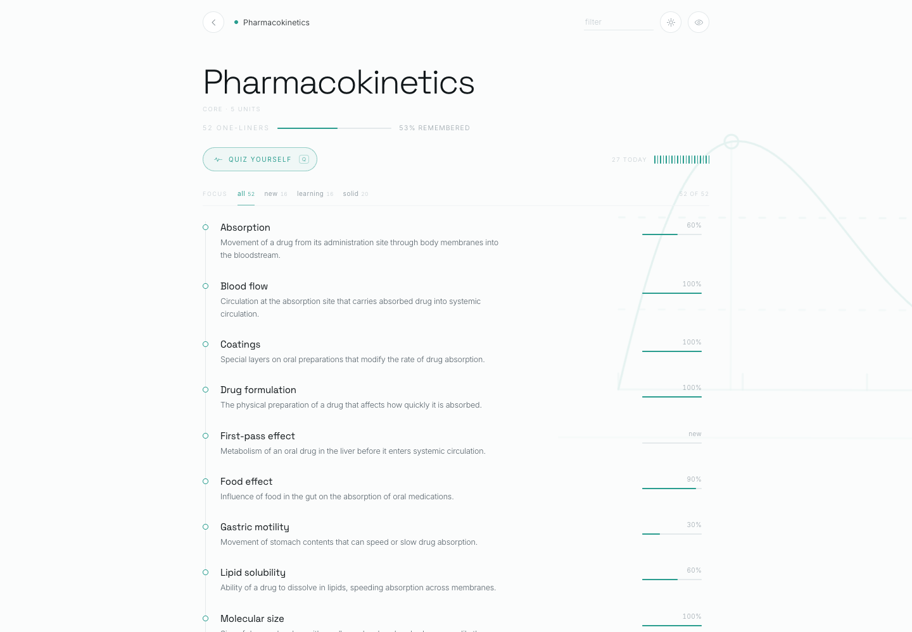
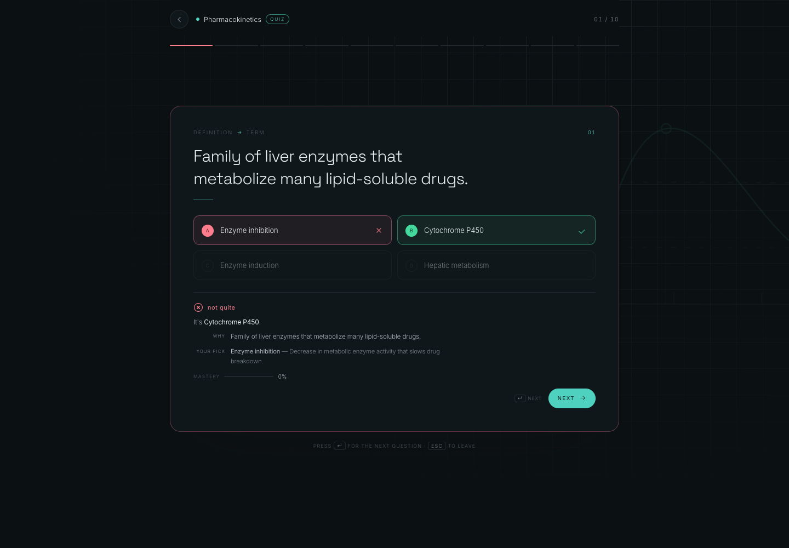
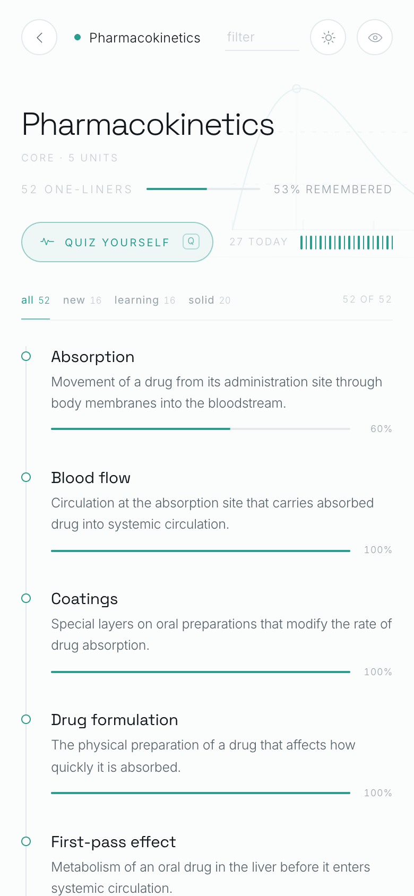

<div align="center">
  
</div>

<div align="center">

# one·liners · Pharmacology

**Pharmacology, in one line.**

A quiet pharmacology study instrument: 270 definitions across 5 subjects — kinetics, dynamics, drug classes, interactions and special populations — with an adaptive two-way quiz and a memory of what you actually know.

<a href="https://abhinav-prabhakar.github.io/PharmacologyDefinitions/">
  
</a>

<br /><br />


</div>

<p align="center"><sub>Screenshots use sample study data. The app itself starts clean, on your device.</sub></p>

---

## Why this exists

Pharmacology is a wall of vocabulary before it is anything else. *Bioavailability*, *first-pass effect*, *therapeutic index*, *inverse agonist* — each is one sentence long and shows up on every exam. **one·liners** gives each term exactly one line, quizzes it in both directions, and quietly schedules the ones you keep missing.

Cool clinical paper, hairline rules, a geometric display face. Each subject keeps its own colour, the way a dispensary colour-codes its shelves. No accounts, no server, no noise.

> **Recognition is not recall.** Knowing *first-pass effect* when you see it is not the same as naming it from its description. So the quiz asks both ways.

---

## Screenshots

<table>
  <tr>
    <td width="50%">
      
      <p align="center"><sub><strong>Light by default</strong> · today, activity, subject mastery</sub></p>
    </td>
    <td width="50%">
      
      <p align="center"><sub><strong>Dark when you choose it</strong> · remembered across visits</sub></p>
    </td>
  </tr>
</table>

<table>
  <tr>
    <td width="58%">
      
      <p align="center"><sub><strong>Every definition has a memory.</strong> Hover a row for its mastery and source.</sub></p>
    </td>
    <td width="42%">
      
      <p align="center"><sub><strong>Answers explain themselves.</strong> The definition, and what you picked.</sub></p>
    </td>
  </tr>
</table>

<div align="center">
  
  <p><sub><strong>320 → 1440px.</strong> The same quiet interface, not a crushed desktop.</sub></p>
</div>

---

## What's inside

**270 one-liners** across **5 subjects**, written for nursing and pre-health students.

- **Core** — Pharmacokinetics, Pharmacodynamics
- **Clinical** — Major Drug Classes, Adverse Effects and Drug Interactions, Special Populations

| Subject | Definitions | Units |
| --- | ---: | --- |
| **Pharmacokinetics** | 52 | Absorption · Distribution · Metabolism · Excretion · Bioavailability and half-life |
| **Pharmacodynamics** | 52 | Receptors and ligands · Agonists and antagonists · Dose-response relationships · Therapeutic index and safety · Tolerance and dependence |
| **Major Drug Classes** | 62 | Cardiovascular drugs · Central nervous system drugs · Antimicrobials · Endocrine and metabolic drugs · GI, respiratory, and analgesic drugs |
| **Adverse Effects and Drug Interactions** | 52 | Adverse drug reactions · Drug-drug interactions · Drug-food and drug-disease interactions · Toxicity and overdose · Pharmacovigilance and reporting |
| **Special Populations** | 52 | Pediatrics · Geriatrics · Pregnancy and lactation · Renal impairment · Hepatic impairment |

Every definition is one sentence, 8–28 words, and carries a source locator. Hover a
definition's mastery rail to see where it came from. Coverage, gaps and assumptions are
documented in [`data/README.md`](data/README.md).

---

## Two directions of recall

Every round mixes both question types, balanced 5/5. You cannot coast on recognition.

| Prompt | You choose | What it trains |
| --- | --- | --- |
| `Therapeutic index` | one of four definitions | term → meaning |
| “Metabolism of an oral drug in the liver before it enters systemic circulation.” | one of four terms | meaning → term |

- **The term is never in the question.** When a definition has to mention its own term, the
  quiz blanks it out, so meaning → term tests meaning.
- **Wrong answers that look right.** Distractors come from each definition's curated
  look-alikes, then from similar wording in the same unit — never four random strangers.
- **Adaptive sampling.** The three weakest definitions are guaranteed a slot; the rest are
  weighted toward low mastery.
- **Keyboard complete.** <kbd>1</kbd>–<kbd>4</kbd> or <kbd>A</kbd>–<kbd>D</kbd> to choose,
  <kbd>Enter</kbd> for next, <kbd>Esc</kbd> to leave, <kbd>r</kbd> to repeat a round.

---

## A memory you can see

Mastery is one confidence score per definition, stored locally: **+30%** for a correct answer,
**−40%** for a miss. Four clean answers reach 100%.

| After | Score | Reads as |
| --- | --- | --- |
| no attempts | 0% | `new` |
| 1 correct | 30% | `learning` |
| 2 correct | 60% | `familiar` |
| 3 correct | 90% | `solid` |
| a miss | −40% | re-learn |

The subject page shows a 2px bar on every definition; cards show a bar profile of the whole
subject; the home page has a daily goal stack and a quiet, monochrome activity trail.

---

## Offline, installable, private

- **Full PWA** — manifest, service worker, maskable icons. Works offline after the first load.
  Install from the browser's own menu (Chrome: the install icon in the address bar; iOS Safari:
  **Share → Add to Home Screen**; macOS Safari: **File → Add to Dock**).
- **No accounts, no analytics, no server.** Progress lives in `localStorage` under
  `oneliners.pharmacology.*` and never leaves the device.
- **Self-hosted type** — Inter, Space Grotesk. No external font requests.
- **Light by default**, dark when you choose it, remembered before first paint.

---

## Sources

| Source | Publisher | License |
| --- | --- | --- |
| [Pharmacology for Nurses](https://openstax.org/details/books/pharmacology) | OpenStax (Rice University) | CC BY-NC-SA 4.0 |
| [Nursing Pharmacology](https://wtcs.pressbooks.pub/pharmacology/) | WisTech Open (Chippewa Valley Technical College) | CC BY 4.0 |
| [Essentials of Pharmacology](https://med.libretexts.org/Courses/University_of_Illinois_Chicago/Essentials_of_Pharmacology) | Medicine LibreTexts (University of Illinois Chicago) | CC BY 4.0 |
| [Drug Therapy](https://medlineplus.gov/drugtherapy.html) | National Library of Medicine (MedlinePlus) | Public domain (US government) |
| [Drugs@FDA Glossary of Terms](https://www.fda.gov/drugs/drug-approvals-and-databases/drugsfda-glossary-terms) | U.S. Food and Drug Administration (FDA) | Public domain (US government) |
| [Population Pharmacokinetics: Guidance for Industry](https://www.fda.gov/media/128793/download) | U.S. Food and Drug Administration (FDA) | Public domain (US government) |

Definitions are paraphrased one-liners, not excerpts. Raw source material is not redistributed.

> [!IMPORTANT]
> Educational vocabulary only; not medical advice, prescribing guidance, or patient-specific recommendations.

---

## Run it locally

```bash
# A server is required: the app fetches its data.
python3 -m http.server 8000
# → http://localhost:8000/
```

No build step, no dependencies. `index.html` is the whole app.

```text
.
├── index.html             # the entire app
├── manifest.webmanifest   # PWA manifest
├── sw.js                  # offline app shell + data cache
├── data/
│   ├── curriculum.json    # sections and subjects the app loads
│   ├── sources.json       # where every definition comes from
│   ├── collection.json    # scope, audience, assumptions
│   ├── README.md          # coverage report
│   └── subjects/*.json    # one file per subject
└── assets/                # icons, social card, screenshots, fonts
```

---

## The one·liners family

Same instrument, different vocabularies. Each has its own look, data and progress.

| Collection | Repository |
| --- | --- |
| [Electronics, in one line.](https://abhinav-prabhakar.github.io/ECEDefinitions/) | [`Abhinav-Prabhakar/ECEDefinitions`](https://github.com/Abhinav-Prabhakar/ECEDefinitions) |
| [Anatomy and physiology, in one line.](https://abhinav-prabhakar.github.io/AnatomyDefinitions/) | [`Abhinav-Prabhakar/AnatomyDefinitions`](https://github.com/Abhinav-Prabhakar/AnatomyDefinitions) |
| [Electricity, in one line.](https://abhinav-prabhakar.github.io/NECDefinitions/) | [`Abhinav-Prabhakar/NECDefinitions`](https://github.com/Abhinav-Prabhakar/NECDefinitions) |
| [HVAC, in one line.](https://abhinav-prabhakar.github.io/HVACDefinitions/) | [`Abhinav-Prabhakar/HVACDefinitions`](https://github.com/Abhinav-Prabhakar/HVACDefinitions) |
| [Medicine, in one line.](https://abhinav-prabhakar.github.io/MedicalDefinitions/) | [`Abhinav-Prabhakar/MedicalDefinitions`](https://github.com/Abhinav-Prabhakar/MedicalDefinitions) |
| [Nursing, in one line.](https://abhinav-prabhakar.github.io/NursingDefinitions/) | [`Abhinav-Prabhakar/NursingDefinitions`](https://github.com/Abhinav-Prabhakar/NursingDefinitions) |
| **[Pharmacology, in one line.](https://abhinav-prabhakar.github.io/PharmacologyDefinitions/)** | [`Abhinav-Prabhakar/PharmacologyDefinitions`](https://github.com/Abhinav-Prabhakar/PharmacologyDefinitions) |
| [Plumbing, in one line.](https://abhinav-prabhakar.github.io/PlumbingDefinitions/) | [`Abhinav-Prabhakar/PlumbingDefinitions`](https://github.com/Abhinav-Prabhakar/PlumbingDefinitions) |
| [Software, in one line.](https://abhinav-prabhakar.github.io/SoftwareDefinitions/) | [`Abhinav-Prabhakar/SoftwareDefinitions`](https://github.com/Abhinav-Prabhakar/SoftwareDefinitions) |
| [The law, in one line.](https://abhinav-prabhakar.github.io/LegalDefinitions/) | [`Abhinav-Prabhakar/LegalDefinitions`](https://github.com/Abhinav-Prabhakar/LegalDefinitions) |

### Credits

Definitions are paraphrased from openly licensed pharmacology texts listed above. Built on the [one·liners](https://github.com/Abhinav-Prabhakar/ECEDefinitions) engine. Fonts: Inter, Space Grotesk (SIL Open Font License 1.1).

<div align="center">
  <sub>If this helps you pass a pharm exam, star the repo — it keeps the shelves stocked.</sub>
</div>
